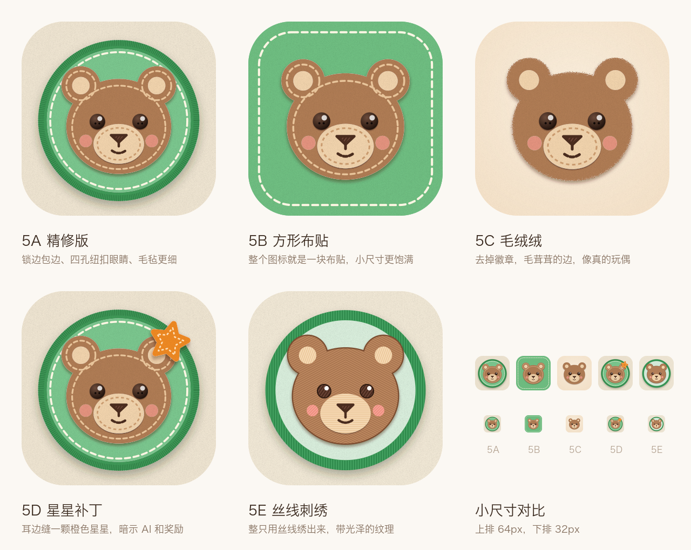

# 小熊伴学 logo

定稿风格：**毛绒刺绣**（布贴、缝线、纽扣眼睛、毛毡质感）。

| 用途 | 用哪个 | 源文件 |
| --- | --- | --- |
| 需要圆形的地方（网页导航、页脚、头像位） | 圆形徽章（5A） | `source/logo-round.svg` |
| 需要方形的地方（App 图标、favicon、应用商店） | 方形布贴（5B） | `source/logo-square.svg`（直角，平台自己切圆角）<br>`source/logo-square-rounded.svg`（自带圆角，透明底） |
| 备用素材，暂未使用 | 毛绒小熊（5C） | `source/plush-bear.svg` |



## 文件

- `source/`：SVG 源文件，所有 PNG 都从这里导出。
  - `android-background.svg` / `android-foreground.svg`：安卓自适应图标的两层。小熊在 66dp 安全区里，不管桌面切成圆形还是圆角方形都完整。
- `png/`：导出的 PNG。
  - `logo-round-*`：透明底。
  - `logo-square-*`：不透明直角。
  - `logo-square-rounded-*`：透明圆角。
  - `plush-bear-*`：透明底。
- `alternates/3d-clay/`：备选方案「立体软萌」，1A–1E 五个变体（SVG + PNG + 对比板）。目前不用，只是存档。
- `explorations/v3-plush/`：毛绒方向的五个变体 5A–5E 和对比板，记录当时的选择。

## 改了 logo 之后

改 `source/` 里的 SVG，然后运行：

```bash
scripts/brand-export.sh
```

需要 `rsvg-convert` 和 ImageMagick（`brew install librsvg imagemagick`）。脚本会重新生成并覆盖：

- `brand/png/`
- iPad / iPhone 图标：`ipad/LittleBearTutor/Assets.xcassets/AppIcon.appiconset/AppIcon.png`
- 安卓启动图标：`app/src/main/res/mipmap-*/ic_launcher_{background,foreground}.png`，由 `mipmap-anydpi-v26/ic_launcher.xml` 组合
- 网页图标：`web/{site,teacher,parent,hanzi,poems}/brand/` 里的 favicon、apple-touch-icon，以及圆形 logo（各页面顶栏或导航的品牌位）

App 里的小熊形象（iPad `BearView` / `BearOrb`，安卓 `Bear` / `BearView`）和网页里的大插画小熊（官网首屏、语音老师的光环）是吉祥物，不是 logo，还是原来用代码画的那一套。

## 颜色

| | 色值 |
| --- | --- |
| 毛毡绿 | `#6fbf82` / `#7cc78f` |
| 深绿包边 | `#3f9a58` / `#2f7e45` |
| 小熊棕 | `#b07d55` |
| 奶油色 | `#f2d4ad` |
| 缝线米白 | `#fff6e4` |
| 腮红 | `#f29a8a` |
| 星星橙（点缀） | `#f08a24` |
