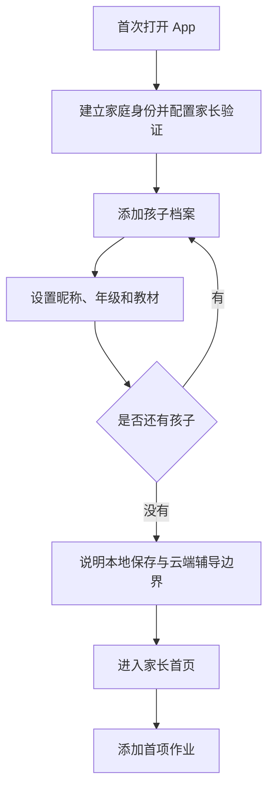
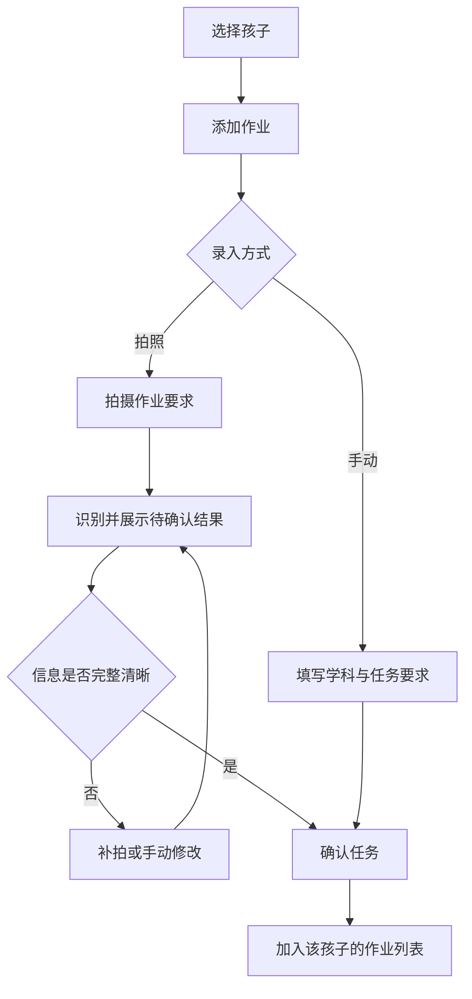
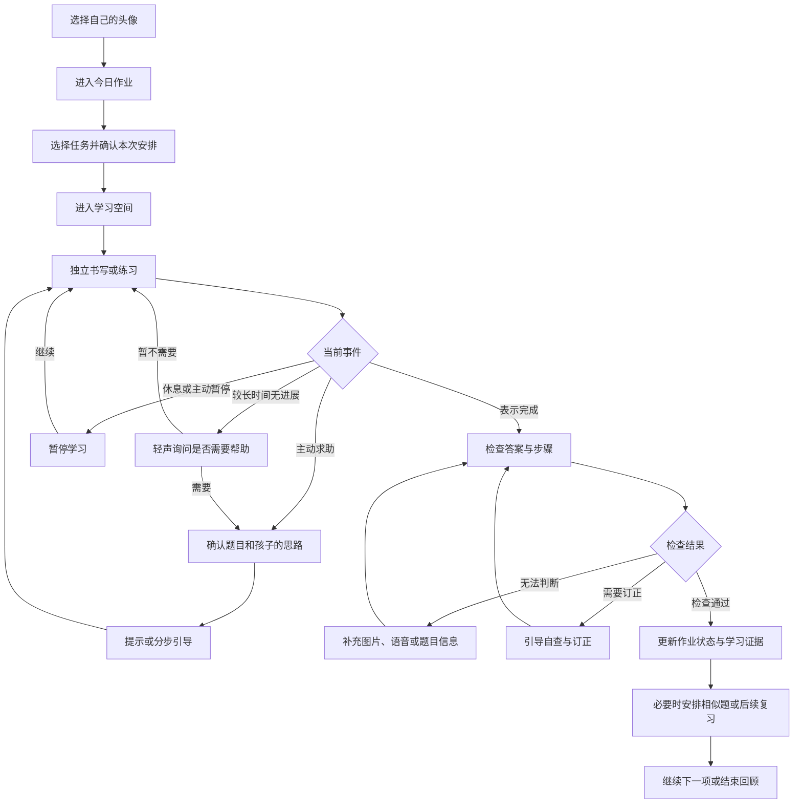

# 家长端与孩子端核心流程

对应需求：[首版需求文档](./prd-v0.1.md)。本文件为首轮交互原型的设计输入，具体布局和文案可在原型中调整。

## 1. 页面结构

| 区域 | 页面 | 主要内容 |
| --- | --- | --- |
| 公共 | 家庭入口 | 孩子头像列表、家长入口、当前设备本地数据说明 |
| 家长端 | 孩子管理 | 添加孩子、年级、教材、学习设置 |
| 家长端 | 作业管理 | 按孩子查看任务，手动添加、拍照导入、修改 |
| 家长端 | 识别确认 | 原图与识别结果、学科、任务要求、确认保存 |
| 家长端 | 学习反馈 | 完成与订正情况、知识变化、依据及需要协助事项 |
| 家长端 | 权限与数据 | 音视频权限、本地数据说明、删除入口 |
| 孩子端 | 学习首页 | 当前孩子、开始写作业、问老师、练一练 |
| 孩子端 | 今日作业 | 作业列表、进度、选择下一项、补充作业 |
| 孩子端 | 学习空间 | 小动物导师、语音、白板、当前任务、求助和检查 |
| 孩子端 | 练习与复习 | 短练习、反馈、再次尝试 |
| 孩子端 | 本次回顾 | 已完成内容、学会的内容、需要继续尝试的内容 |

## 2. 家长首次配置

- 教材未确定时可暂存为待确认，不代替家长猜测版本。
- 麦克风和摄像头在实际使用时说明用途并申请权限。
- 设备检测提供摄像头预览，确认方向、清晰度和可拍摄范围。

## 3. 家长添加作业

任务录入不要求同时获取所有题目。孩子开始学习后，可以再拍摄具体作业页面。避免将作业通知的识别结果与实际题目内容混为一谈。

## 4. 孩子完成作业

检查通过不等于知识掌握；对使用较多提示的任务，需要其他独立表现进一步验证。相似题不必强制在每道作业后出现，结合学习负担决定当场验证或留待复习。

## 5. 学习空间的交互建议

横屏布局以学习材料与白板为主，小动物导师占较小区域。

- 顶部：当前孩子、当前任务和学习状态。
- 主区域：作业画面或白板，可放大查看题目与批注。
- 导师区域：角色形象、简短字幕、倾听或讲解状态。
- 底部：语音开关、摄像头状态、帮我看看、我写好了、暂停。

动作约定：

1. 孩子说“帮我看看这一步”，获取相关清晰画面并确认题目位置。
2. 需要讲解时，在白板上逐步展示内容，语音与重点标记对应。
3. 孩子插话时，停止当前讲解并接收问题，保留白板上下文。
4. 安静学习时不持续说话或播放吸引注意力的动作。
5. 摄像头关闭后明确提示视觉不可用，仍可继续纯语音交流。

## 6. 练习与知识档案更新

选择知识点或接收推荐 → 完成短练习 → 记录回答与提示情况 → 给出反馈 → 更新学习证据 → 决定继续练习或后续复习。

- 数学可通过图示、口述思路或新题检验理解。
- 语文可采用听写、朗读背诵、阅读追问和写话引导。
- 英语可采用听辨、跟读、听写和情境对话。
- 每次更新保留依据，家长可从知识状态回看相关学习记录。

## 7. 家长查看反馈

进入家长端并验证身份 → 选择孩子 → 查看当日任务 → 查看困难与订正 → 查看知识点依据 → 调整后续安排。

报告建议分为：

- 已完成、待继续和待订正的作业。
- 独立完成与使用帮助的情况。
- 已观察到的困难和需要进一步确认的判断。
- 建议的后续练习，以及需要家长协助的具体事项。

报告不以摄像头推断的情绪或注意力评分评价孩子，不默认呈现“认真程度”分数。

## 8. 需要在原型中覆盖的异常情况

| 情况 | 处理方式 |
| --- | --- |
| 外接摄像头未连接或断开 | 提示检查连接，提供自带摄像头拍照入口，保留当前任务 |
| 图片模糊、遮挡或题目不完整 | 显示需要补充的区域，允许重拍或手动补充 |
| 不清楚孩子指的是哪里 | 高亮候选位置或请孩子选择，确认后再讲解 |
| 语音识别不确定 | 请求重说或触控输入，不记录为知识错误 |
| 云端响应失败或断网 | 保存已有本地进度，提示智能辅导暂不可用，允许重试 |
| 切换孩子 | 暂停当前会话，确认目标档案，隔离上下文 |
| App 被关闭后重开 | 恢复已保存任务进度，学习会话由孩子决定是否继续 |
| 删除孩子档案 | 家长验证并确认范围，删除关联本地记录与文件 |

## 9. 原型验证顺序

1. 家长创建两个孩子并分别添加作业，验证身份与数据归属。
2. 孩子从首页进入一项数学作业，完成视觉求助、提示和订正闭环。
3. 验证语文字词或朗读任务，以及英语听读任务的差异交互。
4. 展示知识档案中的依据与推荐练习，验证家长能否理解报告。
5. 在首发 iPad 上验证摄像头、语音打断、断网和重启恢复。

先完成上述流程，再扩展角色装扮、更多练习形式和更主动的视觉观察。
